# Architecture

AXamlIDE is an Avalonia desktop app plus one helper program of its own, and it starts several outside tools as child
processes. This page shows the main parts and how they talk to each other. [flows.md](flows.md) follows individual
actions through the code step by step, and [api-glossary.md](api-glossary.md) lists the third-party calls.

## The three projects

| Project | What it is | May reference |
|---|---|---|
| `AXamlIDE` (repo root) | The app: views, view models, the editor, DI wiring | Avalonia, AvaloniaEdit, Dock, `AXamlIDE.Core` |
| `Projects/AXamlIDE.Core` | Everything that has no UI: LSP client, debug adapter client, workspace, Git, NuGet, search, the AXAML completion engine | **No Avalonia** (see the comment in `AXamlIDE.Core.csproj`) |
| `Projects/AXamlIDE.msbuildhost` | A separate console program that evaluates `.csproj` files with the installed SDK's MSBuild | `Microsoft.Build`, `Microsoft.Build.Locator` |

`AXamlIDE.Core` uses the same namespaces as the app (`AXamlIDE.Services.*`, `AXamlIDE.Models`), so whether a class
lives in the app or in Core can't be told from its namespace. The folder tells you.

`HostProtocol.cs` (the request and response records sent to the MSBuild host) is compiled into both the host and
Core: `AXamlIDE.Core.csproj` links it in. That way the two sides can't drift apart.

## Component diagram

```mermaid
flowchart TB
    subgraph App["AXamlIDE process"]
        direction TB
        Boot["Program.Main → App.OnFrameworkInitializationCompleted<br/>AppServices.Build (DI container)"]

        subgraph Shell["Shell"]
            MW["MainWindow<br/>(KeyMap attached)"]
            MWVM["MainWindowViewModel"]
            Start["StartWindow / StartViewModel"]
        end

        subgraph Docking["Docking"]
            DLVM["DockLayoutViewModel"]
            DF["DockFactory (Dock model)"]
            DVC["DockViewCache"]
            TP["ToolPanels"]
        end

        subgraph Editor["Editor (one per document tab)"]
            DV["DocumentView"]
            EPV["EditorPaneView<br/>(AvaloniaEdit TextEditor)"]
            CTX["EditorContext"]
            CTRL["Controllers: Typing, Completion, Hover,<br/>SignatureHelp, CodeActions, CodeLens,<br/>Folding, Navigation, Snippets..."]
        end

        subgraph Panels["Tool panel view models"]
            WVM["WorkspaceViewModel"]
            EVM["ExplorerViewModel"]
            RVM["RunViewModel<br/>(+ .Debug, .Startup, .Publish)"]
            GVM["GitViewModel"]
            SVM["SearchViewModel"]
            PVM["ProblemsViewModel"]
            DBG["Locals / Watch / CallStack VMs"]
        end

        subgraph Services["App services"]
            DM["DocumentManager<br/>(open files: source of truth)"]
            DSS["DocumentSaveService"]
            LSS["LanguageSessionService"]
            NAV["NavigationService"]
            PS["PreviewSessions → PreviewPaneViewModel"]
            APP["AvaloniaPreviewProcess"]
            GST["GitStatusTracker"]
            DST["DebugSnapshotTracker"]
        end

        MSG(["IMessenger<br/>(WeakReferenceMessenger.Default)"])
    end

    subgraph Core["AXamlIDE.Core (library, same process)"]
        WM["WorkspaceModel"]
        SL["SolutionLoader"]
        MBC["MsBuildHostClient"]
        LM["LspManager"]
        LC["LspClient"]
        XLS["XamlLanguageService"]
        XCS["XamlCompletionService<br/>→ CompletionEngine (dnlib)"]
        DPR["DotNetProjectRunner"]
        NCD["NetCoreDbgSession"]
        GS["GitService"]
        WSS["WorkspaceSearchService"]
    end

    subgraph External["Child processes"]
        HOST["AXamlIDE.msbuildhost"]
        ROS["roslyn-language-server"]
        NETDBG["netcoredbg"]
        DOTNET["dotnet build / run / publish"]
        DESIGN["Avalonia designer host<br/>(dotnet exec ... --method avalonia-remote)"]
        GIT["git"]
    end

    Boot --> MW
    Boot --> Start
    MW --> MWVM
    MWVM --> DLVM
    DLVM --> DF
    DVC -- "builds views for tabs" --> DV
    DVC --> TP
    DV --> EPV
    EPV --> CTX
    CTX --> CTRL

    DLVM -- "Documents / ActiveChanged events" --> DM
    LSS -- "Opened / Closing / Saving / Saved events" --> DM
    CTX --> LSS
    CTX --> XLS
    LSS --> LM
    LM --> LC
    LC -- "JSON-RPC over stdio" --> ROS

    WVM --> WM
    WVM --> SL
    SL --> MBC
    WM --> MBC
    MBC -- "one JSON line each way, stdio" --> HOST
    XLS --> WM
    XLS --> XCS

    RVM --> DPR
    DPR --> DOTNET
    RVM --> NCD
    NCD -- "Debug Adapter Protocol, stdio" --> NETDBG

    PS --> XLS
    PS --> APP
    APP -- "BSON over TCP (Avalonia.Remote.Protocol)" --> DESIGN

    GVM --> GS
    GST --> GS
    GS --> GIT
    SVM --> WSS

    MSG -.-> MWVM
    MSG -.-> DLVM
    MSG -.-> EPV
    MSG -.-> NAV
    MSG -.-> PVM
    MSG -.-> DST
    NAV --> DM
```

Solid arrows are direct calls through a reference the class was given in its constructor. Dotted arrows are messages
delivered by `IMessenger`. The diagram leaves out smaller pieces (NuGet, Publish, Terminal, Test Explorer,
Properties, the image viewer, visualizers). They follow the same patterns.

## How the parts talk to each other

The code uses four ways to connect parts. Which one a class uses tells you how tightly it is tied to the class it talks to.

### 1. Constructor injection (`AppServices.cs`)

`AppServices.Build()` is the composition root. Every service and view model is registered as a **singleton** in a
`Microsoft.Extensions.DependencyInjection` container, and it gets what it needs as constructor parameters.
`ValidateOnBuild = true` makes a missing registration fail at startup, not on first use. `App.axaml.cs` calls
`services.Dispose()` on exit, which disposes every `IDisposable` singleton. That includes `WorkspaceModel`, which
kills the MSBuild host, and `LspManager`, which disposes each client.

Some singletons are resolved in `App.OnFrameworkInitializationCompleted` only so that they get created and start
listening: `GitTreeDecorator`, `DocumentReloader` and `XamlCacheKeeper`. Nothing else asks for them.

Two kinds of object are **not** in the container and are created by hand:

- each editor: `DockViewCache.DocumentViewFor` → `new DocumentView(tab, _editorServices, preview)` →
  `new EditorPaneView()` + `Initialize(services)`. Each editor's controllers are created in
  `EditorPaneView.Initialize`.
- per-document and per-session objects: `DocumentDockable`, `PreviewPaneViewModel` (made by `PreviewSessions.For`),
  `NetCoreDbgSession` (made in `RunViewModel.DebugProjectAsync`), `LspClient` (made by `LspManager.StartAsync`).

### 2. C# events on `DocumentManager`

`DocumentManager` (`Services/Documents/DocumentManager.cs`) is the single source of truth for open files. Other
parts subscribe to its events and are never called by it directly:

| Event | Subscribers |
|---|---|
| `Opened` | `LanguageSessionService.OnDocumentOpened` (sends didOpen), `RunViewModel.TrackDocument` (breakpoints), `DocumentReloader` (watches the file on disk) |
| `Closing` | `LanguageSessionService.OnDocumentClosing` (sends didClose), `RunViewModel.UntrackDocument`, `PreviewSessions.OnDocumentClosing`, `DocumentReloader` |
| `Saving` | `LanguageSessionService.OnDocumentSaving` (flushes pending edits) |
| `Saved` | `LanguageSessionService.OnDocumentSaved` (sends didSave), `XamlCacheKeeper`, `GitStatusTracker` (refreshes status), `FileChangeWatcher` (marks the write as ours) |
| `ActiveChanged` | `DockLayoutViewModel.OnActiveDocumentChanged`, `DockViewCache.PlaceSharedViews`, `MainWindowViewModel.UpdateEditorStatus`, `OutlineViewModel` |
| `Documents.CollectionChanged` | `DockLayoutViewModel.OnDocumentsChanged` (adds and removes tabs), `ProblemsViewModel` |
| `FrontRequested` | `DockLayoutViewModel.OnActiveDocumentChanged` |

`WorkspaceViewModel` raises `Opened` and `Closed` in the same way. `WorkspaceSession`, `StartViewModel` (recent
list), `RunViewModel` and `TestExplorerViewModel` listen to `Opened`.

### 3. Messages (`IMessenger`)

When the sender should not know who reacts, it sends a record from `Messages/` through `IMessenger`. To find the
handler, search for `IRecipient<ThatMessage>` or `Register<..., ThatMessage>`.

| Message | Sent by | Handled by |
|---|---|---|
| `StatusMessage` | many | `MainWindowViewModel` (status bar) |
| `OpenWorkspaceMessage` | `StartViewModel.Choose`, `App.Start` (reopen last) | `MainWindowViewModel` |
| `ShowToolTabMessage` | `RunViewModel`, `ProblemsViewModel`, `WatchViewModel`, `TestExplorerViewModel` | `DockLayoutViewModel` |
| `EditorActionMessage` | `EditorCommands` (menus and key bindings) | `EditorPaneView` (only the pane showing the active document acts) |
| `DiagnosticsChangedMessage` | `LanguageSessionService` | `EditorPaneView`, `ProblemsViewModel` |
| `EditorStateChangedMessage` | `EditorPaneView` (caret moved, diagnostics redrawn) | `MainWindowViewModel` |
| `NavigateToSearchResultMessage` | `SearchViewModel.OpenResult` | `NavigationService` |
| `NavigateToProblemMessage` | `ProblemsViewModel` | `NavigationService` |
| `NavigateToOutlineItemMessage` | `OutlineViewModel` | `NavigationService` |
| `NavigateToDebugLocationMessage` | `RunViewModel.DebugProjectAsync` (on a stop) | `NavigationService` |
| `DebugSnapshotChangedMessage` | `RunViewModel.Debug` | `DebugSnapshotTracker` |
| `DebugSessionChangedMessage` | `RunViewModel.OnIsDebuggingChanged` | `DockLayoutViewModel` (adds or removes Locals, Watch, Call Stack) |
| `BuildStartedMessage` / `BuildFinishedMessage` | `RunViewModel` | `PreviewSessions` (pause or resume previews), `XamlCacheKeeper` (finished only) |
| `FilesCreatedMessage` | `WorkspaceEditService` | `WorkspaceViewModel` |
| `PreviewProblemMessage` | `PreviewPaneViewModel` | `ProblemsViewModel` |
| `AddWatchMessage` | `EditorPaneView`, `DebugValueNode`, `CollectionDataTip` | `WatchViewModel` |
| `VisualizeDebugValueMessage` | `DebugValueTree`, `CollectionDataTip` | `VisualizerManager` |
| `DebugValuesEditedMessage` | `DebugValueTree` | `DebugSnapshotTracker` |
| `FocusFindInFilesMessage` | `MainWindowViewModel.ShowFindInFiles` | `SearchViewModel` |

The messenger is `WeakReferenceMessenger.Default`. Recipients register themselves with `messenger.RegisterAll(this)`
in their constructor, and `EditorPaneView` unregisters in `Shutdown()`.

### 4. Narrow interfaces and "ask the document"

- **`IDocumentHost`** (`Services/Documents/IDocumentHost.cs`, implemented by `DocumentHost`): how the editor and
  navigation open files and bring a tab to the front without knowing about tabs or windows.
- **`OpenDocument.Reveal(offset, length)`**: navigation asks the *document*, not an editor, to show a range. The
  `EditorPaneView` showing that document (`OnRevealRequested` → `ApplyPendingReveal`) selects, scrolls and focuses.
  If no editor exists yet, the request waits in `PendingReveal` until one is created (`SetDocument` checks it).
- **`EditorServices`** (`Services/Editor/EditorServices.cs`): a record with everything an editor pane needs from
  outside, handed over once in `EditorPaneView.Initialize`.
- **`IDialogService`** / **`IClipboardService`**: view models ask for dialogs, file pickers and the clipboard through
  these, so they never touch a `Window`.

## Threading

- The UI thread owns `DocumentManager`, `OpenDocument`, every view model and `LspManager`'s state.
- `LspClient` reads from the server on a background loop (`ReadLoopAsync`). `LspManager` posts its events back to the
  UI `SynchronizationContext` it captured in its constructor (`PostToUi`). `LanguageSessionService.OnDiagnosticsPublished`
  uses `Dispatcher.UIThread.Post`.
- `MsBuildHostClient` is synchronous: it allows one request at a time, under `_lock`. Callers move it off the UI thread
  with `Task.Run` (`WorkspaceViewModel.OpenSolutionAsync`, `ProjectTreeNode.PopulateAsync`,
  `XamlLanguageService.GetProjectAsync`, `RunViewModel.ResolveDebugProgram`).
- Debugger events from `NetCoreDbgSession` and `DebugInspector` arrive off the UI thread. `RunViewModel.Debug` wraps
  its handlers in `Dispatcher.UIThread.Post`.

## Where the docking fits

The Dock library keeps a *model* of the layout (docks, tabs, floating windows). `DockLayoutViewModel` is the only class
that changes that model, and it keeps it in step with `DocumentManager`: one `DocumentDockable` per open document.
`DockFactory` (a subclass of Dock's `Factory`) builds the starting layout and knows where each tool panel goes back to
(`PutBack`).

Dock asks for views through a "control recycling" cache. `App.UseDockViews` puts `DockViewCache` on every
`DockControl` as `ControlRecyclingDataTemplate.ControlRecycling`. `DockViewCache.Build` returns:

- a `DocumentView` for a `DocumentDockable` (made once, then moved when the tab is dragged);
- a page view (`DiffView`, `NuGetView`, `PublishView`, `VisualizerView`, `ImageView`) for a `PageDockable`;
- `ToolPanels.ViewFor(id)` for a `ToolDockable`.

The comment on `DockViewCache` explains why these views are kept out of app-wide data templates: Dock's tab headers
and drag preview would otherwise try to show the same editor control a second time.

## Outside programs

| Program | Started by | Protocol | Found by |
|---|---|---|---|
| `AXamlIDE.msbuildhost` | `MsBuildHostClient.Start` (first use of `WorkspaceModel.Host`) | One JSON line per request and response, stdin/stdout | `AXAMLIDE_HOST`, else `msbuildhost/` beside the app |
| `roslyn-language-server` | `LspManager.StartAsync` → `LspClient.StartAsync` | LSP: JSON-RPC 2.0, `Content-Length` framing, stdio | `AXAMLIDE_ROSLYN`, else `~/.dotnet/tools`, else `PATH` (`LspServers.FindTool`) |
| `netcoredbg` | `new NetCoreDbgSession(...)` in `RunViewModel.DebugProjectAsync` | Debug Adapter Protocol over stdio (`DebugAdapterTransport`) | `AXAMLIDE_NETCOREDBG_PATH`, else `netcoredbg/` beside the app, else `PATH` |
| `dotnet` | `DotNetProjectRunner.ExecuteAsync` | Plain output lines | `PATH` |
| Avalonia designer host | `AvaloniaPreviewProcess.StartAsync` (`dotnet exec ... --transport tcp-bson://127.0.0.1:<port>/ --method avalonia-remote`) | `Avalonia.Remote.Protocol` BSON over TCP | `XamlPreviewTarget.HostAppPath` (worked out by `XamlPreviewTargetResolver`) |
| `git` | `GitService` (its own `ProcessStartInfo("git")`); `GitClone` (through `LineProcess.RunAsync`) | Plain output | `PATH` |

The MSBuild host is a separate process because it loads the installed SDK's MSBuild assemblies with
`MSBuildLocator.RegisterDefaults()`. The `.csproj` comment explains why: shipping its own copies would cause version
conflicts. `SolutionLoader` and the rest of Core never reference `Microsoft.Build`.

## Where to look for...

| To change... | Start in |
|---|---|
| What gets registered, and as which class | `AppServices.cs` |
| Startup (start window or reopen the last workspace) | `App.Start` |
| The starting dock layout, or adding a tool panel | `ViewModels/DockFactory.cs`, `Shell/ToolPanels.cs`, `Messages/ToolTab.cs` |
| A keyboard shortcut | `Shell/KeyMap.cs` (`WireCommands`), Core `Services/Keymaps/*.json` |
| An editor feature | `Views/EditorPaneView.axaml.cs` (`Initialize`), then the controller in `Editor/` |
| Adding a language server | `LspServers` in `Projects/AXamlIDE.Core/Services/Lsp/LspServers.cs` |
| Project evaluation | `Projects/AXamlIDE.msbuildhost/Program.cs`, `MsBuildHostClient` |
