# Architecture

AXamlIDE is an Avalonia desktop app plus one helper program of its own and one extension it loads into the Roslyn
language server, and it starts several outside tools as child processes. This page shows the main parts and how they talk to each other. [flows.md](flows.md) follows individual
actions through the code step by step, and [api-glossary.md](api-glossary.md) lists the third-party calls.

## The projects

| Project | What it is | May reference |
|---|---|---|
| `AXamlIDE` (repo root) | The app: views, view models, the editor, DI wiring | Avalonia, AvaloniaEdit, Dock, `AXamlIDE.Core` |
| `Projects/AXamlIDE.Core` | Everything that has no UI: LSP client, debug adapter client, workspace, Git, NuGet, search, the AXAML completion engine | **No Avalonia** (see the comment in `AXamlIDE.Core.csproj`) |
| `Projects/AXamlIDE.msbuildhost` | A separate console program that evaluates `.csproj` files with the installed SDK's MSBuild | `Microsoft.Build`, `Microsoft.Build.Locator` |
| `Projects/AXamlIDE.RoslynExtension` | An assembly the Roslyn language server loads into its own process, whose handlers work on the server's live `Solution` (see [below](#our-extension-inside-the-roslyn-server)) | The installed server's Roslyn assemblies, not copied |

`AXamlIDE.Core` uses the same namespaces as the app (`AXamlIDE.Services.*`, `AXamlIDE.Models`), so whether a class
lives in the app or in Core can't be told from its namespace. The folder tells you.

`HostProtocol.cs` (the request and response records sent to the MSBuild host) is compiled into both the host and
Core: `AXamlIDE.Core.csproj` links it in. That way the two sides can't drift apart. `ExtensionProtocol.cs` (the
messages to and from the Roslyn extension) is shared the same way.

## Component diagram

```mermaid
flowchart TB
    subgraph App["AXamlIDE process"]
        direction TB
        Boot["Program.Main → App.OnFrameworkInitializationCompleted<br/>AppServices.Build (DI container)"]

        subgraph Shell["Shell"]
            MW["MainWindow<br/>(KeyMap attached)"]
            MWVM["MainWindowViewModel"]
            Start["StartWindow / StartViewModel"]
        end

        subgraph Docking["Docking"]
            DLVM["DockLayoutViewModel"]
            DF["DockFactory (Dock model)"]
            DVC["DockViewCache"]
            TP["ToolPanels"]
        end

        subgraph Editor["Editor (one per document tab)"]
            DV["DocumentView"]
            EPV["EditorPaneView<br/>(AvaloniaEdit TextEditor)"]
            CTX["EditorContext"]
            CTRL["Controllers: Typing, Completion, Hover,<br/>SignatureHelp, CodeActions, CodeLens,<br/>Folding, Navigation, Snippets..."]
        end

        subgraph Panels["Tool panel view models"]
            WVM["WorkspaceViewModel"]
            EVM["ExplorerViewModel"]
            RVM["RunViewModel<br/>(+ .Debug, .Startup, .Publish)"]
            GVM["GitViewModel"]
            ACVM["AgentChatViewModel<br/>(the Claude panel)"]
            SVM["SearchViewModel"]
            PVM["ProblemsViewModel"]
            DBG["Locals / Watch / CallStack VMs"]
        end

        subgraph Services["App services"]
            DM["DocumentManager<br/>(open files: source of truth)"]
            DSS["DocumentSaveService"]
            LSS["LanguageSessionService"]
            XAS["XamlAnalysisService<br/>(AXAML diagnostics)"]
            NAV["NavigationService"]
            PS["PreviewSessions → PreviewPaneViewModel"]
            APP["AvaloniaPreviewProcess"]
            GST["GitStatusTracker"]
            DST["DebugSnapshotTracker"]
            SAS["SolutionAnalysisService<br/>(closed files' diagnostics)"]
        end

        MSG(["IMessenger<br/>(WeakReferenceMessenger.Default)"])
    end

    subgraph Core["AXamlIDE.Core (library, same process)"]
        WM["WorkspaceModel"]
        SL["SolutionLoader"]
        MBC["MsBuildHostClient"]
        LM["LspManager"]
        LC["LspClient"]
        REC["RoslynExtensionClient"]
        XLS["XamlLanguageService"]
        XCS["XamlCompletionService<br/>→ CompletionEngine (dnlib)"]
        DPR["DotNetProjectRunner"]
        NCD["DebugSession"]
        GS["GitService"]
        ACP["AcpClient"]
        CMW["CommitMessageWriter"]
        WSS["WorkspaceSearchService"]
    end

    subgraph External["Child processes"]
        HOST["AXamlIDE.msbuildhost"]
        ROS["roslyn-language-server"]
        REXT["AXamlIDE.RoslynExtension<br/>(loaded into the server)"]
        NETDBG["netcoredbg"]
        DOTNET["dotnet build / run / publish"]
        DESIGN["Avalonia designer host<br/>(dotnet exec ... --method avalonia-remote)"]
        GIT["git"]
        AGENT["claude-agent-acp<br/>(downloaded on request; claude CLI beside it)"]
    end

    Boot --> MW
    Boot --> Start
    MW --> MWVM
    MWVM --> DLVM
    DLVM --> DF
    DVC -- "builds views for tabs" --> DV
    DVC --> TP
    DV --> EPV
    EPV --> CTX
    CTX --> CTRL

    DLVM -- "Documents / ActiveChanged events" --> DM
    LSS -- "Opened / Closing / Saving / Saved events" --> DM
    CTX --> LSS
    CTX --> XLS
    LSS --> LM
    LM --> LC
    LC -- "JSON-RPC over stdio" --> ROS
    SAS --> REC
    SAS -- "workspace/diagnostic, if the extension won't load" --> LC
    REC -- "extension messages, over the same connection" --> LC
    ROS -- "loads, runs its handlers" --> REXT

    WVM --> WM
    WVM --> SL
    SL --> MBC
    WM --> MBC
    MBC -- "one JSON line each way, stdio" --> HOST
    XLS --> WM
    XLS --> XCS
    XAS --> XLS
    XAS -- "Opened / Closing events" --> DM

    RVM --> DPR
    DPR --> DOTNET
    RVM --> NCD
    NCD -- "Debug Adapter Protocol, stdio" --> NETDBG

    PS --> XLS
    PS --> APP
    APP -- "BSON over TCP (Avalonia.Remote.Protocol)" --> DESIGN

    GVM --> GS
    GVM --> CMW
    CMW -- "claude -p, diff on stdin" --> AGENT
    ACVM --> ACP
    ACP -- "Agent Client Protocol: JSON-RPC, one line per message, stdio" --> AGENT
    GST --> GS
    GS --> GIT
    SVM --> WSS

    MSG -.-> MWVM
    MSG -.-> DLVM
    MSG -.-> EPV
    MSG -.-> NAV
    MSG -.-> PVM
    MSG -.-> DST
    MSG -.-> XAS
    NAV --> DM
```

Solid arrows are direct calls through a reference the class was given in its constructor. Dotted arrows are messages
delivered by `IMessenger`. The diagram leaves out smaller pieces (NuGet, Publish, Terminal, Test Explorer,
Properties, the image viewer, visualizers). They follow the same patterns.

## How the parts talk to each other

The code uses four ways to connect parts. Which one a class uses tells you how tightly it is tied to the class it talks to.

### 1. Constructor injection (`AppServices.cs`)

`AppServices.Build()` is the composition root. Every service and view model is registered as a **singleton** in a
`Microsoft.Extensions.DependencyInjection` container, and it gets what it needs as constructor parameters.
`ValidateOnBuild = true` makes a missing registration fail at startup, not on first use. `App.axaml.cs` calls
`services.Dispose()` on exit, which disposes every `IDisposable` singleton. That includes `WorkspaceModel`, which
kills the MSBuild host, and `LspManager`, which disposes each client.

Some singletons are resolved in `App.OnFrameworkInitializationCompleted` only so that they get created and start
listening: `GitTreeDecorator`, `DocumentReloader`, `XamlCacheKeeper` and `XamlAnalysisService`. Nothing else asks
for them.

Two kinds of object are **not** in the container and are created by hand:

- each editor: `DockViewCache.DocumentViewFor` → `new DocumentView(tab, _editorServices, preview)` →
  `new EditorPaneView()` + `Initialize(services)`. Each editor's controllers are created in
  `EditorPaneView.Initialize`.
- per-document and per-session objects: `DocumentDockable`, `PreviewPaneViewModel` (made by `PreviewSessions.For`),
  `DebugSession` (made in `RunViewModel.DebugProjectAsync`), `LspClient` (made by `LspManager.StartAsync`).

### 2. C# events on `DocumentManager`

`DocumentManager` (`Services/Documents/DocumentManager.cs`) is the single source of truth for open files. Other
parts subscribe to its events and are never called by it directly:

| Event | Subscribers |
|---|---|
| `Opened` | `LanguageSessionService.OnDocumentOpened` (sends didOpen), `XamlAnalysisService.Start` (AXAML files' own diagnostics), `RunViewModel.TrackDocument` (breakpoints), `DocumentReloader` (watches the file on disk) |
| `Closing` | `LanguageSessionService.OnDocumentClosing` (sends didClose), `XamlAnalysisService.Stop`, `RunViewModel.UntrackDocument`, `PreviewSessions.OnDocumentClosing`, `NavigationService` (drops the file from back/forward history), `DocumentReloader` |
| `Saving` | `LanguageSessionService.OnDocumentSaving` (flushes pending edits) |
| `Saved` | `LanguageSessionService.OnDocumentSaved` (sends didSave), `XamlCacheKeeper`, `GitStatusTracker` (refreshes status), `FileChangeWatcher` (marks the write as ours) |
| `ActiveChanged` | `DockLayoutViewModel.OnActiveDocumentChanged`, `DockViewCache.PlaceSharedViews`, `StatusBarViewModel.OnActiveDocumentChanged`, `OutlineViewModel`, `ProblemsViewModel` (Current Document / Project scope), `NavigationService.OnActiveChanged` (back/forward history), `ExplorerViewModel` (Track Active Item, when that setting is on), `AgentChatViewModel` (the active file's name in the Claude panel) |
| `Documents.CollectionChanged` | `DockLayoutViewModel.OnDocumentsChanged` (adds and removes tabs), `ProblemsViewModel` |
| `FrontRequested` | `DockLayoutViewModel.OnActiveDocumentChanged` |

`WorkspaceViewModel` raises `Opened` and `Closed` in the same way. `WorkspaceSession`, `StartViewModel` (recent
list), `RunViewModel` and `TestExplorerViewModel` listen to `Opened`.

### 3. Messages (`IMessenger`)

When the sender should not know who reacts, it sends a record from `Messages/` through `IMessenger`. To find the
handler, search for `IRecipient<ThatMessage>` or `Register<..., ThatMessage>`.

| Message | Sent by | Handled by |
|---|---|---|
| `StatusMessage` | many | `StatusBarViewModel` (back to "Ready" after 10 s; tooltip keeps the last 15) |
| `OpenWorkspaceMessage` | `StartViewModel.Choose`, `App.Start` (reopen last) | `MainWindowViewModel` |
| `ShowToolTabMessage` | `RunViewModel`, `ProblemsViewModel`, `WatchViewModel`, `TestExplorerViewModel`, `ExplorerViewModel`, `StatusBarViewModel` | `DockLayoutViewModel` |
| `EditorActionMessage` | `EditorCommands` (menus and key bindings) | `EditorPaneView` (only the pane showing the active document acts) |
| `DiagnosticsChangedMessage` | `LanguageSessionService` (language servers), `XamlAnalysisService` (AXAML) | `EditorPaneView`, `ProblemsViewModel`, `StatusBarViewModel` |
| `SolutionDiagnosticsChangedMessage` | `SolutionAnalysisService` | `ProblemsViewModel`, `StatusBarViewModel` |
| `EditorStateChangedMessage` | `EditorPaneView` (caret moved, diagnostics redrawn) | `StatusBarViewModel` |
| `NavigateToSearchResultMessage` | `SearchViewModel.OpenResult`, `TestExplorerViewModel`, `MarkdownPreviewView` (links to files), `AgentChatViewModel` (file links in Claude's replies) | `NavigationService` |
| `NavigateToProblemMessage` | `ProblemsViewModel`, `RunViewModel.OpenOutputLine` (double-click an error in Output) | `NavigationService` |
| `NavigateToOutlineItemMessage` | `OutlineViewModel` | `NavigationService` |
| `NavigateToDebugLocationMessage` | `RunViewModel.DebugProjectAsync` (on a stop), `CallStackViewModel` (picking a frame) | `NavigationService` |
| `DebugSnapshotChangedMessage` | `RunViewModel.Debug` | `DebugSnapshotTracker` |
| `DebugSessionChangedMessage` | `RunViewModel.OnIsDebuggingChanged` | `DockLayoutViewModel` (adds or removes Locals, Watch, Call Stack) |
| `BuildStartedMessage` / `BuildFinishedMessage` | `RunViewModel` | `PreviewSessions` (pause or resume previews); finished only: `XamlCacheKeeper`, `XamlAnalysisService` (checks for obsolete uses again) |
| `BuildProblemsMessage` | `RunViewModel.BuildWithNoticeAsync` (the parsed build output), `ClearBuildProblems` | `ProblemsViewModel` |
| `FilesCreatedMessage` | `WorkspaceEditService` | `WorkspaceViewModel` |
| `PreviewProblemMessage` | `PreviewPaneViewModel` | `ProblemsViewModel` (the preview's row), `XamlAnalysisService` (puts a squiggle where the error is) |
| `AddWatchMessage` | `EditorPaneView`, `DebugValueNode`, `CollectionDataTip` | `WatchViewModel` |
| `VisualizeDebugValueMessage` | `DebugValueTree`, `CollectionDataTip` | `VisualizerManager` |
| `DebugValuesEditedMessage` | `DebugValueTree` | `DebugSnapshotTracker` |
| `FocusFindInFilesMessage` | `MainWindowViewModel.ShowFindInFiles` | `SearchViewModel` |

The messenger is `WeakReferenceMessenger.Default`. Recipients register themselves with `messenger.RegisterAll(this)`
in their constructor, and `EditorPaneView` unregisters in `Shutdown()`.

### 4. Narrow interfaces and "ask the document"

- **`IDocumentHost`** (`Services/Documents/IDocumentHost.cs`, implemented by `DocumentHost`): how the editor and
  navigation open files and bring a tab to the front without knowing about tabs or windows.
- **`OpenDocument.Reveal(offset, length)`**: navigation asks the *document*, not an editor, to show a range. The
  `EditorPaneView` showing that document (`OnRevealRequested` → `ApplyPendingReveal`) selects, scrolls and focuses.
  If no editor exists yet, the request waits in `PendingReveal` until one is created (`SetDocument` checks it).
- **`EditorServices`** (`Services/Editor/EditorServices.cs`): a record with everything an editor pane needs from
  outside, handed over once in `EditorPaneView.Initialize`.
- **`IDialogService`** / **`IClipboardService`**: view models ask for dialogs, file pickers and the clipboard through
  these, so they never touch a `Window`.

## Threading

- The UI thread owns `DocumentManager`, `OpenDocument`, every view model and `LspManager`'s state.
- `LspClient` reads from the server on a background loop (`ReadLoopAsync`). `LspManager` posts its events back to the
  UI `SynchronizationContext` it captured in its constructor (`PostToUi`). `LanguageSessionService.OnDiagnosticsPublished`
  uses `Dispatcher.UIThread.Post`.
- `MsBuildHostClient` is synchronous: it allows one request at a time, under `_lock`. Callers move it off the UI thread
  with `Task.Run` (`WorkspaceViewModel.OpenSolutionAsync`, `ProjectTreeNode.PopulateAsync`,
  `XamlLanguageService.GetProjectAsync`, `RunViewModel.ResolveDebugProgram`).
- Debugger events from `DebugSession` and `DebugInspector` arrive off the UI thread. `RunViewModel.Debug` wraps
  its handlers in `Dispatcher.UIThread.Post`.

## Where the docking fits

The Dock library keeps a *model* of the layout (docks, tabs, floating windows). `DockLayoutViewModel` is the only class
that changes that model, and it keeps it in step with `DocumentManager`: one `DocumentDockable` per open document.
`DockFactory` (a subclass of Dock's `Factory`) builds the starting layout and knows where each tool panel goes back to
(`PutBack`).

Dock asks for views through a "control recycling" cache. `App.UseDockViews` puts `DockViewCache` on every
`DockControl` as `ControlRecyclingDataTemplate.ControlRecycling`. `DockViewCache.Build` returns:

- a `DocumentView` for a `DocumentDockable` (made once, then moved when the tab is dragged);
- a page view (`DiffView`, `NuGetView`, `PublishView`, `VisualizerView`, `ImageView`, and `AgentChatView` for the
  Claude tab) for a `PageDockable`;
- `ToolPanels.ViewFor(id)` for a `ToolDockable`.

The comment on `DockViewCache` explains why these views are kept out of app-wide data templates: Dock's tab headers
and drag preview would otherwise try to show the same editor control a second time.

## Outside programs

| Program | Started by | Protocol | Found by |
|---|---|---|---|
| `AXamlIDE.msbuildhost` | `MsBuildHostClient.Start` (first use of `WorkspaceModel.Host`) | One JSON line per request and response, stdin/stdout | `AXAMLIDE_HOST`, else `msbuildhost/` beside the app |
| `roslyn-language-server` | `LspManager.StartAsync` → `LspClient.StartAsync` | LSP: JSON-RPC 2.0, `Content-Length` framing, stdio | `AXAMLIDE_ROSLYN`, else `~/.dotnet/tools`, else `PATH` (`LspServers.FindTool`) |
| `AXamlIDE.RoslynExtension` (an assembly the server loads, not a program) | `RoslynExtensionClient.ActivateAsync`, the first time `SolutionAnalysisService` starts the live analysis on a server | `server/_vs_activateExtension`, then `workspace/_vs_dispatchExtensionMessage` (a message name and JSON text in, JSON text out) over the server's LSP connection | `roslynextension/` beside the app (`RoslynExtensionClient.AssemblyPath`) |
| `netcoredbg` | `new DebugSession(...)` in `RunViewModel.DebugProjectAsync` | Debug Adapter Protocol over stdio (`DebugAdapterTransport`) | `AXAMLIDE_NETCOREDBG_PATH`, else `netcoredbg/` beside the app, else `PATH` |
| `dotnet` | `DotNetProjectRunner.ExecuteAsync` | Plain output lines | `PATH` |
| Avalonia designer host | `AvaloniaPreviewProcess.StartAsync` (`dotnet exec ... --transport tcp-bson://127.0.0.1:<port>/ --method avalonia-remote`) | `Avalonia.Remote.Protocol` BSON over TCP | `XamlPreviewTarget.HostAppPath` (worked out by `XamlPreviewTargetResolver`) |
| `git` | `GitService` (its own `ProcessStartInfo("git")`); `GitClone` (through `LineProcess.RunAsync`) | Plain output | `PATH` |
| `claude-agent-acp` | `AcpClient.StartAsync`, from `AgentChatViewModel.StartAsync` when the Claude panel is first shown | Agent Client Protocol: JSON-RPC 2.0, one JSON message per line, stdio (`AcpClient.Transport.cs`) | `ClaudeAgentInstall.FindAgent` (its install folder under the OS's local app data). If it isn't there, the panel offers to download it from GitHub (`FindLatestReleaseAsync`, `InstallAsync`), only when its button is clicked |
| `claude` (Claude Code CLI, installed beside the agent) | `CommitMessageWriter.WriteAsync` (the Git panel's sparkle button) | `claude -p --model haiku --tools ""` with the diff on stdin; the reply is the message | `ClaudeAgentInstall.FindCli` |

The MSBuild host is a separate process because it loads the installed SDK's MSBuild assemblies with
`MSBuildLocator.RegisterDefaults()`. The `.csproj` comment explains why: shipping its own copies would cause version
conflicts. `SolutionLoader` and the rest of Core never reference `Microsoft.Build`.

## Our extension inside the Roslyn server

Roslyn's own `workspace/diagnostic` goes through every file of the solution each time anything changes (about a minute
for this repo), so solution-wide analysis asks our extension instead. The server loads
`Projects/AXamlIDE.RoslynExtension` into its own process (`server/_vs_activateExtension`) and runs its handlers on
the same live `Solution` its LSP features use, unsaved edits included. There's no second copy of Roslyn.

- **The API.** The handlers implement `IExtensionWorkspaceMessageHandler<TMessage, TResponse>` from
  `Microsoft.CodeAnalysis.Extensions` (in `Microsoft.CodeAnalysis.Workspaces`). It's public but marked experimental
  (`RSEXPERIMENTAL008`, "subject to change or removal"), and no NuGet release has it yet (5.12.0 doesn't). So the
  project compiles against the installed server's own assemblies (the `.csproj` comment says where it looks), and
  the server's copies are used at run time. Everything else in the server (its LSP handlers, the `ExternalAccess`
  assemblies) is internal and open only to Microsoft's own assemblies.
- **The messages** (`ExtensionProtocol.cs`). `ProjectsHandler` returns the projects and their versions (cheap).
  `ProjectDiagnosticsHandler` returns one project's compiler diagnostics, file by file. Each file's are cached
  (`DiagnosticCache`) by its text version and a key for what all files depend on: the top-level semantic version,
  generated sources, `.editorconfig`, options and references. So after an edit inside a method body only that file
  is checked again (about 300 ms here). `ProjectCompilationDiagnosticsHandler` compiles the whole project for what
  the file checks can't see (unused fields CS0169/CS0414/CS0649, no `Main` CS5001), less what they already report.
  The extension can't send anything unasked, so the IDE asks: see [flows.md, flow 16](flows.md#16-solution-wide-analysis).
- **The fallback.** If the extension isn't there (built without the server installed), won't load, or fails, the
  IDE uses `workspace/diagnostic` (a long poll with partial results) and writes the reason to the debug output,
  in lines starting `[solution analysis]`.

### When roslyn-language-server updates

The extension API is experimental, so check it after every server update, and above all when a stable (non-preview)
release comes out:

1. **Build.** The extension compiles against the new assemblies. A compile error in `Projects/AXamlIDE.RoslynExtension`
   means the API changed. If the store has two versions after an update, the build uses the last one listed. Remove
   the old one, or set `RoslynServerDir`.
2. **Run.** Open a solution with solution-wide analysis on, then type an error into a file and close it. In the debug
   output, `[solution analysis] <project>: N files checked in … ms` means the extension is working. `Roslyn extension
   not loaded (…)` or `failed (…)` means the IDE fell back: the reason says why (a renamed request, a changed
   message, a handler the server didn't register).
3. **The package.** If a NuGet release of `Microsoft.CodeAnalysis.Workspaces.Common` now has
   `Microsoft.CodeAnalysis.Extensions`, reference it instead of the tool's store (with `ExcludeAssets="runtime"`, as
   the MSBuild host does), so building no longer needs the server installed. Take `RSEXPERIMENTAL008` out of the
   `NoWarn` and build: if nothing complains, the API is no longer experimental and the `NoWarn` can stay out.
4. **Is it still needed?** Roslyn's own `workspace/diagnostic` may have got faster. Time a full pass on a large
   solution with and without the extension (delete `roslynextension/` from the output to force the fallback). If
   they're close, the fallback alone may do.

## Where to look for...

| To change... | Start in |
|---|---|
| What gets registered, and as which class | `AppServices.cs` |
| Startup (start window or reopen the last workspace) | `App.Start` |
| The starting dock layout, or adding a tool panel | `ViewModels/DockFactory.cs`, `Shell/ToolPanels.cs`, `Messages/ToolTab.cs` |
| A keyboard shortcut | `Shell/KeyMap.cs` (`WireCommands`), Core `Services/Keymaps/*.json` |
| An editor feature | `Views/EditorPaneView.axaml.cs` (`Initialize`), then the controller in `Editor/` |
| Solution-wide analysis (closed files' errors), Run Code Analysis | `Services/Languages/SolutionAnalysisService.cs`, Core `Services/Lsp/RoslynExtensionClient.cs`, `Projects/AXamlIDE.RoslynExtension/` |
| AXAML diagnostics (xmlns problems, `[Obsolete]` uses, the preview's error) | `Services/Languages/XamlAnalysisService.cs`, Core `Services/Xaml/XamlNamespaceAnalysis.cs` / `XamlObsoleteAnalysis.cs`, Core `Services/Preview/PreviewErrorDiagnostic.cs` |
| The Claude panel | `ViewModels/AgentChatViewModel*.cs` (start, turn, history, attachments), `Views/AgentChatView.axaml`, Core `Services/Agents/` |
| The editor's find/replace bar | `Styles/SearchPanelTheme.axaml` (our template for AvaloniaEdit's `SearchPanel`) |
| Adding a language server | `LspServers` in `Projects/AXamlIDE.Core/Services/Lsp/LspServers.cs` |
| Project evaluation | `Projects/AXamlIDE.msbuildhost/Program.cs`, `MsBuildHostClient` |
